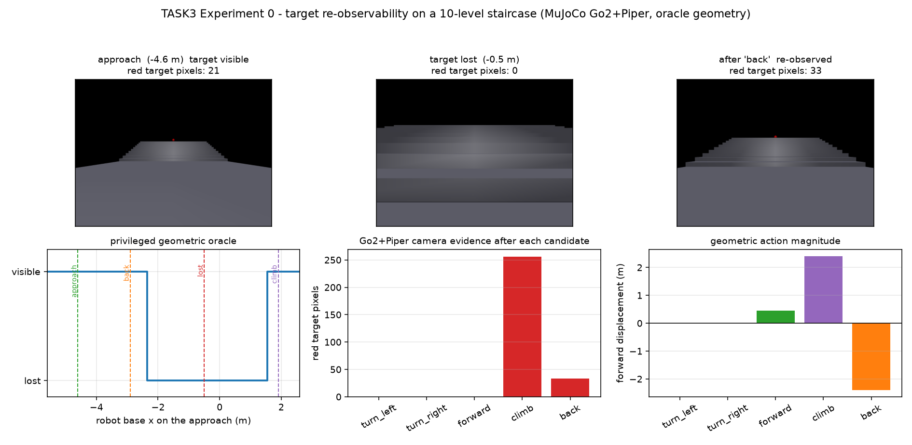
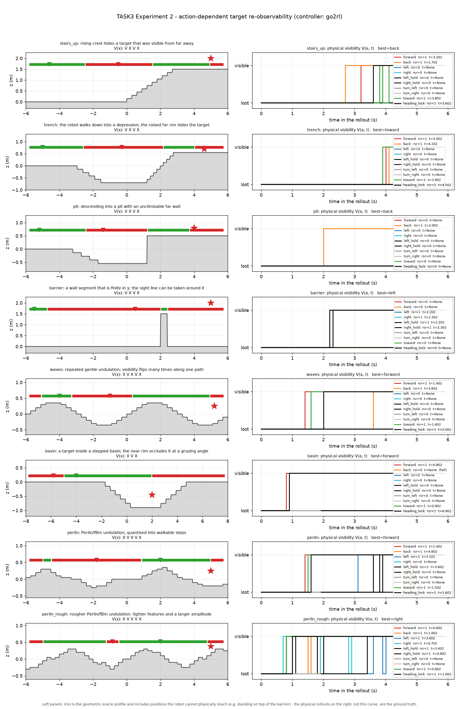
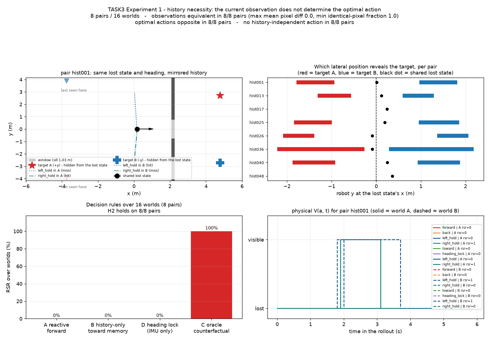
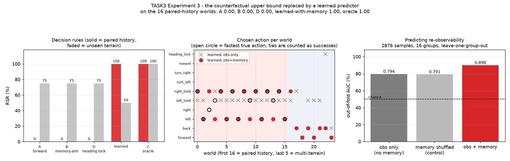
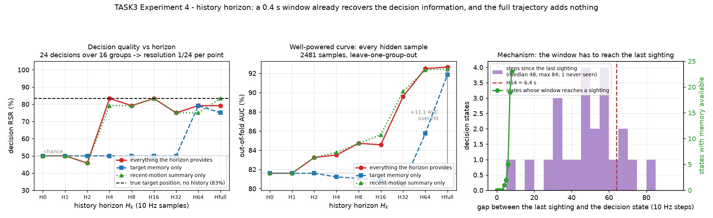
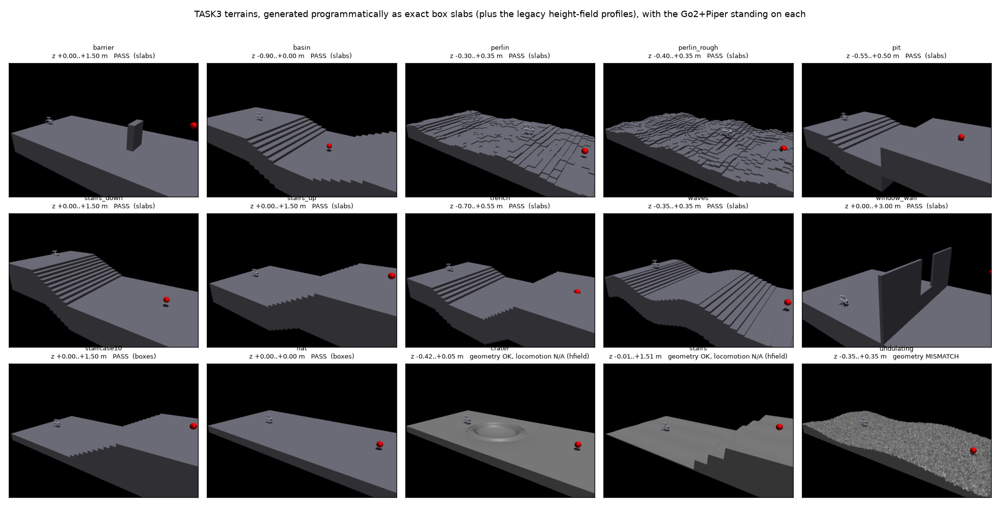
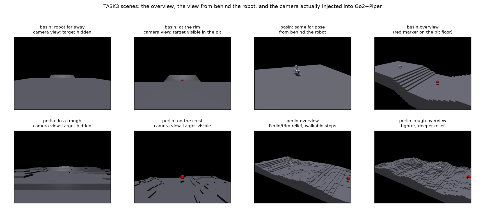

# TASK3：地形导致的目标重新可观测性（Terrain-Induced Target Re-observability）

> **关于本文档的范围。** 这份文档记录 TASK3 的**全部**工作，包括论文实验。
> 但随任务接口发布的只有：`api.py`、`scenes.py`、`slabs.py`、`terrain.py`、
> `benchmark.py`、`benchmark_api.py`、`episode.py`、`controllers.py`、
> `locomotion.py`、`go2_piper_camera.py`、`realsense.py`、`terrain_viewer.py`、
> `mechanism_table.py`、`test_api.py`、`task3.yaml`。
>
> **下文命令区里出现的 `figure_*.py`、`history*.py`、`experiment.py`、
> `visibility_model.py`、`consequence_*.py`、`solvability.py` 等实验脚本不随任务发布**，
> 直接运行会 `FileNotFoundError`。想跑通它们需要论文仓库中的对应脚本。
>
> 另外，第 5–8 节的实验结论**已经过审计修正**：主实验的成功判定未以相机检测为准、
> 目标记忆中含真值目标坐标、且 Random 与 Learned 的场景分母不一致，因此旧结果
> 不再支持"非特权视觉闭环优于随机策略"。仍然成立的是 H1/H2/H3 三组对照实验与
> 地形/接口本身。

TASK3 研究一个很窄的问题：

> **机器人曾经观察到目标，但因为它自己的运动、地形几何或遮挡，目标暂时不可见；机器人如何利用目标历史信息，对候选动作产生反事实未来，并选择能让目标重新进入可观测状态的动作？**

核心链路：

```text
Target Memory → Candidate Actions → Counterfactual Imagination
              → Future Observability → Action
```

## 1. 核心现象：可观测性是机器人运动的非单调函数

直觉上“越靠近目标越容易看到”，地形会打破它：

$$\boxed{\text{Closer} \not\Rightarrow \text{More Observable}}$$

机器人沿路径运动 $s_0 \to s_1 \to \dots \to s_n$，可见性 $V(s_i)$ 可以出现一次或多次 `Visible → Invisible → Visible`。本仓库在**真实地形上把 $V(x)$ 量出来**，不假设它：

| 场景 | $V(x)$ 序列 | 翻转次数 |
| --- | --- | ---: |
| `stairs_up` | `V X V X` | 3 |
| `trench` | `V X V X` | 3 |
| `pit` | `V X V X` | 3 |
| `barrier` | `V X V X` | 3 |
| `waves` | `X V X V X` | 4 |
| `basin` | `X V X` | 2 |
| `perlin` | `X V X V X` | 4 |
| `perlin_rough` | `X V X V X` | 4 |

> 这张表是**当前代码重新量出来的**。`perlin` 早期记录为 6 次翻转，那是在 `_walkable` 的 numpy 别名 bug 修好之前；限幅修好后地形起伏变了，翻转数变为 4。引用时以本表为准。

```powershell
python tasks/task3_reobservability/benchmark.py --mode profile   # 秒级，只量 V(x)
```

## 2. 三个假设，按顺序验证

```text
H1  Non-monotonicity        地形遮挡让可观测性随运动非单调变化
        ↓
H2  History                 目标不可见时，历史提供当前观测无法恢复的决策信息
        ↓
H3  Counterfactual planning 预测多个可行动作的未来可观测性可以改进动作选择
```

| 假设 | 状态 | 证据 |
| --- | --- | --- |
| H1 | **成立** | §1 的 $V(x)$ 表（8 场景 × 2–4 次翻转） |
| H2 | **成立** | §6：8 对世界，丢失状态渲染**逐像素完全相同**，最优动作相反，且**没有任何与历史无关的动作可行**（8/8） |
| H3 | **成立（含学习式）** | §6：16 个世界里 A/B/D 全部 0，C 成功 16 次；§7：学习式预测器在同一批 16 个世界上也成功 16 次，只用当前观测的版本只有 8 次 |
| H4 | **成立** | §8：历史收益在 H4（0.4 s）就基本耗尽并达到天花板；完整轨迹相对 H64 只多 **0.002 AUC** |

研究顺序（按不依赖关系推进）：**问题成立 → 历史需要多少 → 现有方法为什么失败 → 学到的模型是否泛化 → 改进是否解决失败**。当前进度：

| 优先级 | 实验 | 状态 |
| --- | --- | --- |
| P0 | History Horizon | **完成（决策侧统计力待补，§8.5）** |
| P0 | **冻结 Benchmark API + 统一 baseline** | **完成（§9）** |
| P0 | **多步 episode 协议（protocol A/B，等时长与可伺服转向原语，统一预算与终止）** | **完成（§9.4）**；24×8 已重跑 |
| P0 | Failure taxonomy（A/B/C/D/E） | **完成（§9.5）**：五个经典 baseline 各 17×B，NBV 额外 2×D |
| P0 | History Horizon（需在**多步协议**上重做） | 单步版已完成（§8），**多步版待做** |
| P1 | Learned scorer 接入（接口已留好：注入式 `scorer(observation, action_id, context)`） | 未做 |
| P1 | Cross-Mechanism Generalization（Setting A/B/C，对应 failure type E） | 未做 |
| P1 | Cross-Mechanism Generalization | 只发现现象（OOD 0.50 vs 基线 0.75），未系统做 |
| P1 | Action-conditioned Future Visibility | 未做（目前只有 binary predictor） |
| P2 | Learned Counterfactual Planning | 未做 |
| P2 | Physical Closed-loop | 已知有动力学偏差，未系统做 |
| P3 | VLM / WAM | 最后 |

## 3. 与已有工作的位置

| 工作 | 目标已看过 | 目标消失 | History | 物理动作 | 未来预测 | 地形导致非单调 V |
| --- | ---: | ---: | ---: | ---: | ---: | ---: |
| Lost Target Search（Radmard & Croft 2017） | ✓ | ✓ | ✓ | ✓ | 部分 | — |
| Occlusion-aware Active Target Search（T-RO 2018） | ✓ | ✓ | ✓ | ✓ | ✓（belief） | occluder 几何 |
| Object Permanence + Actions（2021） | ✓ | ✓ | ✓ | — | hidden state | — |
| Object Permanence Filter（ICRA 2024） | ✓ | ✓ | ✓ | — | state belief | — |
| NBV / Active Perception（含 OA-NBV 2026） | 不一定 | 不一定 | 不一定 | ✓ | viewpoint value | — |
| WoMAP（CoRL 2025） | 不一定 | 不一定 | ✓ | ✓ | ✓ | — |
| NavWAM（2026） | 不一定 | 不一定 | ✓ | ✓ | ✓（egocentric） | — |
| **本工作** | **✓** | **✓** | **✓** | **✓** | **目标可观测性** | **✓** |

所以本文不能声称“首次研究目标丢失后的重新搜索”“首次用主动感知解决重新观察”“首次做候选动作 + World Model”，也不应把标题写成“World Model for lost target search”。定位是：

> **Terrain-induced, non-monotonic target re-observability as an action-selection problem.** World Model 是后续的解，不是贡献本身。

---

## 4. Experiment 0：几何 oracle + 机载相机



`experiment.py` 在丢失锚点上对每个候选动作做反事实评估，输出几何真值、每个候选动作的 `in_camera_fov` / `blocked_by_terrain` / 距离方位俯仰，以及该动作后机载相机渲染的 `target_pixel_count`；同时用射线把 MuJoCo 实际接触面和 oracle 高度逐点比对（`benchmark.py --mode surface`）。

**转视角没有用**：`turn_left` / `turn_right` 在五个场景、十个世界里的 RSR 全部为 0。

## 5. Experiment 2：动作条件未来可观测性



对每个场景：量出几何 $V(x)$ → 从冻结的丢失状态**物理执行**每个候选动作并按 10 Hz 采样完整曲线 $V(a,t)$ → 归约成 RSR / $T_{\text{reobs}}$ / motion cost → 套四条决策规则：

| 规则 | 内容 | 用未来预测？ |
| --- | --- | --- |
| **A 反应式** | 永远向前 | 否 |
| **B History-only** | 朝记忆中的目标方位直走 | 否（用记忆，不看未来） |
| **D Initial Heading Lock** | 保持丢失瞬间的世界朝向（闭环纠偏），不看目标 | 否 |
| **C Oracle 反事实** | 在 MuJoCo 里把每个候选动作都跑一遍，取最优 | 是 |

候选动作是 10 个统一原语（每个平移动作同样 6 s 预算，代价可比）：`forward`、`back`、`left`、`right`、`left_hold`、`right_hold`、`turn_left`、`turn_right`、`toward`、`heading_lock`。

### 5.1 scene × action RSR

| 场景 | forward | back | left | right | left_hold | right_hold | turn_l | turn_r | toward | heading_lock | 最佳 | A | B | D | C |
| --- | ---: | ---: | ---: | ---: | ---: | ---: | ---: | ---: | ---: | ---: | --- | --- | --- | --- | --- |
| `stairs_up` | 1 | 1 | 0 | 0 | 0 | 0 | 0 | 0 | 1 | 1 | back | 1 | 1 | 1 | 1 |
| `trench` | 1 | 1 | 0 | 0 | 0 | 0 | 0 | 0 | 1 | 1 | toward | 1 | 1 | 1 | 1 |
| `pit` | 0 | 1 | 0 | 0 | 0 | 0 | 0 | 0 | 0 | 0 | back | **0** | **0** | **0** | **1** |
| `barrier` | 0 | 0 | 1 | 1 | 1 | 1 | 0 | 0 | 0 | 0 | left | **0** | **0** | **0** | **1** |
| `waves` | 1 | 1 | 0 | 0 | 0 | 0 | 0 | 0 | 1 | 1 | forward | 1 | 1 | 1 | 1 |
| `basin` | 1 | 0 | 0 | 0 | 0 | 0 | 0 | 0 | 1 | 1 | forward | 1 | 1 | 1 | 1 |
| `perlin` | 1 | 1 | 1 | 0 | 1 | 0 | 0 | 0 | 1 | 1 | forward | 1 | 1 | 1 | 1 |
| `perlin_rough` | 1 | 1 | 1 | 1 | 1 | 1 | 0 | 0 | 1 | 1 | right | 1 | 1 | 1 | 1 |

八个场景的接触面校验误差均为 **0.0**（`--mode surface`）。四点结论：

1. **不同动作确实对应不同的未来可观测性**，差异是结构性的。
2. **不存在一个通吃的固定动作**：`forward` 6/8、`back` 6/8、侧移 3/8、转视角 **0/8**。
3. **最佳动作随地形改变**：`back` / `toward` / `forward` / `left` / `right`。
4. `pit` 与 `barrier` 上 A、B、D 全部失败，只有 C 成功；**其余六个场景这三条规则都能过**——这正是必须做 Experiment 1 的原因。

### 5.2 一个重要的反面结果：这五个场景区分不了 IMU

`heading_lock`（基线 D）是“只有 IMU、没有视觉记忆”的策略。它在 `stairs_up` / `trench` / `waves` 上与 `forward` 同样成功，在 `pit` / `barrier` 上与 `forward` 同样失败。也就是说：

> **这五个地形无法把“用 IMU 保持朝向”和“闷头往前走”区分开。**

这正是必须做 Experiment 1 的原因——不是再堆地形。

### 5.3 一个反向发现：几何 oracle 会给出误导性的反事实

`experiment.py` 的 `climb` 是“把眼点沿 yaw 平移 2.40 m”的**瞬移**，物理 `climb` 是 8 秒闭环行走。实测：几何 oracle 答“能看到”，物理 rollout 答“看不到”（横漂 1.54 m，目标出视场）。**“把 MuJoCo 当完美 World Model”只在“动作 = 瞬移”时成立。**

---

## 6. Experiment 1：History Necessity（本文最关键的实验）



Experiment 2 证明“动作决定未来可观测性”，但没有证明**当前观测不够**。Experiment 1 直接问：

> **只看当前这一帧，能不能确定最优的重新观测动作？**

### 6.1 构造

墙上一扇窗（窗台约 1.0 m，走不过去）。每对世界**局部完全相同**：同一地形、同一丢失状态、同一朝向；差别只是目标藏在窗口哪一侧，因而机器人“最后一次看到它”的位置不同。

```text
world A: 目标在窗口 +y 侧，机器人最后一次在 −y 侧看到它
world B: 镜像
```

### 6.2 成对世界不是手挑的：几何搜索 + 预注册判据

`history_pairs.py` 在参数空间里随机搜索，只有同时满足下列判据的才被接受（**这些都是纯几何条件，在任何物理 rollout 之前就固定下来**）：

1. 丢失状态在视场内**被地形**遮挡住目标（不是靠转出视场）；
2. 被遮挡的是**整个目标标记**，不只是中心点；
3. 每个世界都有一个位于自己一侧的历史观测点，在那里能看到自己的目标；
4. 两个世界的横向揭示区间**互不相交**、**位于丢失状态两侧**；
5. 每个揭示区间都落在对应侧移原语的可达范围内；
6. 每个揭示区间**宽度 ≥ 0.6 m**，使 10 Hz 采样不会整段跨过；
7. 从丢失状态**笔直向前或向后**都不会揭示任何目标。

本机结果：**49 个候选参数 → 8 对通过**（拒绝原因见 `generated/history_pairs.json`）。

判据不是事后拟合的，换种子结果稳定：seed 11 / 23 / 37 分别在 49 / 35 / 43 个候选里接受了 8 / 8 / 8 对，最主要的拒绝原因是 `reveal_wide_enough`（揭示区太窄，10 Hz 采样可能整段跨过）。三个种子的逐条判据分别存在 `history_pairs.json`、`history_pairs_seed23.json`、`history_pairs_seed37.json`。

物理验证（§6.4）跑的是 seed 11 的那 8 对；另外两个种子的成对世界只过了几何校验，没有跑物理。

### 6.3 当前观测确实相同（量出来的，不是假设）

| 量 | 8 对上的值 |
| --- | ---: |
| 平均像素差（最大） | **0.0** |
| 最大像素差（最大） | **0** |
| 完全相同像素比例（最小） | **100.0%** |
| 目标像素数 | 全部 **0 / 0** |

$O_A = O_B$ 是逐像素相等的。

### 6.4 结果：8 / 8

| 指标 | 值 |
| --- | ---: |
| 观测等价的对数 | **8 / 8** |
| 最优动作相反的对数 | **8 / 8** |
| **没有任何与历史无关的动作可行的对数** | **8 / 8** |
| `H2_hold_rate` | **1.0** |

16 个世界上的决策规则成功率：

| 规则 | RSR |
| --- | ---: |
| A 反应式（永远向前） | **0 %** |
| B History-only（朝记忆方位走） | **0 %** |
| D Initial Heading Lock（IMU） | **0 %** |
| **C Oracle 反事实** | **100 %** |

最优动作分布：`right_hold` 7、`left` 5、`left_hold` 3、`right` 1 —— 分布在两侧，不存在单一答案。

### 6.5 这证明了什么

1. **$O_A = O_B$ 逐像素相同，而 $a_A^* \neq a_B^*$**：当前观测在信息上不足以确定最优动作，历史携带**决策相关**信息。**H2 成立，8/8。**
2. **没有任何与历史无关的动作在两个世界都成功**：不存在一个“只看现在”的策略能同时解决两个世界。
3. **`heading preservation ≠ target-relative spatial preservation`**：D 在两个世界都保持了丢失瞬间的朝向，仍然只成功 1/16。机器人一旦横向位移，目标相对几何就变了。
4. **知道目标在哪 ≠ 知道该做什么动作**：B（朝记忆中的目标直走）成功率 0%。记忆说“目标在左前方”，而正确动作是**向另一侧平移**（针孔效应）。这正是 H2 与 H3 的分界。

```powershell
python tasks/task3_reobservability/history_pairs.py --pairs 8 --seed 11   # 搜索并校验成对世界
python tasks/task3_reobservability/history.py --pair all \
  --render-dir tasks/task3_reobservability/generated/history_camera
python tasks/task3_reobservability/figure_history.py
```

### 6.6 过程中发现的一个真实陷阱

第一版成对世界的物理结果里，`right` 在一半世界里失败，而 `left` 全部成功。原因是**侧移时策略会偏航**：`right`（vy = −0.6）在 6 秒里偏航到 −0.27 rad，把目标推出 87° 视场；`left` 的偏航方向恰好无害。所以新增了 `left_hold` / `right_hold`：**平移时闭环保持朝向**，不需要任何目标记忆。加上它们之后 8/8 通过。

---

## 7. Experiment 3：把 oracle 上界换成学习式可观测性预测



Experiment 1/2 的 C 是把每个候选动作在 MuJoCo 里真跑一遍再选，是上界不是策略。`visibility_model.py` 问：**能不能直接预测，而不是跑？**

数据直接复用已经录好的物理曲线（`history_necessity.json` + `benchmark.json`）：每条 rollout 曲线按 0.5 s 抽样，每个样本是（机器人状态、候选动作）→ 标签「这段动作里目标是否重新可见」。共 **2876 个样本 / 16 个组**，正例率 0.265。

特征集是实验的全部重点：

| 特征集 | 内容 | 维度 |
| --- | --- | --- |
| `obs_only` | 机器人位姿 + 候选动作。**没有目标记忆** | 19 |
| `obs_memory` | 同上 + 记忆中的目标世界坐标（相对向量、距离、方位） | 25 |
| `obs_memory_shuffled_control` | 同上，但记忆特征被随机置换（保留边缘分布、破坏与状态的关联） | 25 |

**在成对世界里，两个世界共享位姿、朝向与相机图像（已实测逐像素相同），所以任何只依赖这些输入的函数在两个世界上输出必然相同。** 这就是 H2 在学习式设定下的可证版本。

评估用 leave-one-group-out（16 个组），一个世界永远不由见过它的模型打分；再用预测概率 argmax 选动作，用**实测**结果记分。

### 7.1 结果

| 特征集 | OOF AUC | 历史成对世界（16）RSR | 未见地形族（8）RSR |
| --- | ---: | ---: | ---: |
| `obs_only` | 0.794 | **0.50** | 0.375 |
| `obs_memory_shuffled_control` | 0.791 | **0.4375** | 0.375 |
| **`obs_memory`** | **0.898** | **1.00** | 0.50 |

历史成对世界上的决策规则对照（同一批 16 个世界）：

| 规则 | RSR |
| --- | ---: |
| A 反应式 forward | 0.00 |
| B History-only toward | 0.00 |
| D Initial Heading Lock | 0.00 |
| 学习式，只用当前观测 | 0.50 |
| 学习式，记忆被打乱（对照） | 0.4375 |
| **学习式，观测 + 记忆** | **1.00** |
| C Oracle 反事实 | 1.00 |

### 7.2 这说明了什么

1. **学习式预测器在有记忆时达到 oracle 水平**（16/16），而打乱记忆的对照塌回 0.4375 —— 增益确实来自记忆特征，不是过拟合。
2. **只用当前观测的版本塌成近似常数策略**：24 个世界里 18 次都选同一个动作。这正是 H2 在「学习式策略」层面的复现：输入里没有区分两个世界的信息，策略就只能是常数。
3. 逐世界看（图中）：有记忆的版本在 16 个成对世界上的选择是 `right_hold / left` **严格交替**，与真实最优动作一致；只用观测的版本几乎是一整排 `left_hold`。
4. **但在没见过的地形族上它只有 0.50，比 A/B/D 的 0.75 还差。** leave-one-group-out 意味着评估某个地形时模型没见过该地形族。**学习式预测器目前只在自己见过的地形族里成立，不能声称可泛化。** 这是下一步最该补的短板。

```powershell
python tasks/task3_reobservability/visibility_model.py
python tasks/task3_reobservability/figure_model.py
```

---

## 8. Experiment 4：History Horizon（P0）



Experiment 1 证明了「当前观测不足」，但没有回答**到底需要多少历史**。这一节回答它。

```powershell
python tasks/task3_reobservability/history_horizon.py
python tasks/task3_reobservability/figure_horizon.py
```

### 8.1 定义（一次定死，不在不同 horizon 下改特征定义）

$$H_k=\{o_{t-k+1},\dots,o_t\},\qquad \text{观测以 10 Hz 记录}$$

一次观测 $o=(\text{pose},\ \text{target\_seen},\ \text{range},\ \text{bearing},\ \text{elevation})$。**机器人不被告知目标的世界坐标**，必须从窗口内某次「确实看到了目标」的观测里把它反推出来。这正是 horizon 起作用的原因：**窗口够不到那次目击，就等于没有目标记忆。**

**公平性**：特征维度对每个 horizon 都相同（36 维）。窗口被压缩成固定几个槽位——长度对数、时间跨度、窗口起点的机体位移、转角、窗口内是否看到目标、目击年龄、目击时的机位、以及目标在当前机体系下的位置。**变的只是窗口回溯多远，特征定义从不变**，所以不能说 H4 拿到了比 H0 更丰富的表示。

### 8.2 三条方法学决定

1. **只保留「此刻目标不可见」的样本。** 如果目标此刻可见，那「动作后还能看见」这个标签被当前观测直接回答，模型会学成「现在看得见 ⇒ 成功」而不是反事实。决策点本身按构造就是不可见的，全部保留。2481 / 2876 个样本通过过滤。
2. **块消融**：`all`（全部）、`memory`（只有目标记忆，运动摘要清零）、`motion`（只有运动摘要，记忆清零）、`oracle_target`（不给任何历史，直接给真实目标位置）。
3. **上限**：`oracle_target` 回答「如果目标位置已知，这个任务本身可不可解」，与 horizon 无关。

### 8.3 结果

上限：**真实目标位置 + 零历史 = 0.833**。也就是说 24 个决策世界里，有 4 个的正确答案不由 (位姿, 目标位置, 动作) 决定（多半是物理效应：坡度、漂移）。

| horizon | 窗口时长 | `all` RSR | `memory` RSR | `motion` RSR | `all` AUC |
| --- | ---: | ---: | ---: | ---: | ---: |
| H0 | 0 s | 0.500 | 0.500 | 0.500 | 0.816 |
| H1 | 0.1 s | 0.500 | 0.500 | 0.500 | 0.816 |
| H2 | 0.2 s | 0.458 | 0.500 | 0.458 | 0.832 |
| **H4** | **0.4 s** | **0.833** | 0.500 | 0.792 | 0.835 |
| H8 | 0.8 s | 0.792 | 0.500 | 0.792 | 0.847 |
| H16 | 1.6 s | 0.833 | 0.500 | 0.833 | 0.846 |
| H32 | 3.2 s | 0.750 | 0.500 | 0.750 | 0.896 |
| H64 | 6.4 s | 0.792 | 0.792 | 0.750 | 0.925 |
| Hfull | 全程 | 0.792 | 0.750 | 0.833 | **0.927** |

三条结论：

1. **决策：H0–H2 在 chance（0.46–0.50），H4 直接跳到 0.833，也就是天花板本身，之后不再提升。** 完整轨迹并不比 0.4 秒窗口更好。
2. **预测器（2481 个样本，统计力足够）：AUC 从 0.816 单调升到 H64 的 0.925，Hfull 0.927。** 也就是 **+11.1 AUC，其中 H64 之后再涨的只有 0.2**。6.4 秒窗口已经装下几乎所有预测信息。
3. **机制**：目标最后一次被看到是在决策点之前**中位数 48 步（4.8 s）、最大 84 步（8.4 s）**。H64 时 24 个决策状态里有 19 个的窗口够得到那次目击，Hfull 时 23 个。**需要的 horizon 由「目标最后一次被看到有多久」决定，不是一个任意数字。**

### 8.4 一个反直觉的分解

**目标记忆单独要 H64 才有用**（0.500 → 0.792），但 **「最近运动摘要」在 H4 就到 0.79–0.83**。

也就是说，真正在低 horizon 起作用的**不是显式的「目标在哪」，而是「机器人是从哪个方向走过来的」**——在成对世界里，两个世界的接近方向不同，这几步位移就已经足以区分它们。这比「必须重建目标位置」是更强的结论：**一段很短的历史就够了，而且它起作用的方式可以很简单。**

### 8.5 这个实验的统计力限制（必须说）

决策指标只在 **24 个世界**上评测，分辨率是 $1/24=0.042$。所以：

- H0 → H4 的 0.46 → 0.83 是大的、显著的；
- 但 H4 与 H8/H16/H32/H64/Hfull 之间 1–2 个世界的差别**在噪声内**，**不能**读成「哪个 horizon 最好」。

AUC 曲线（2481 个样本，留一组交叉验证）不受这个限制，**「在哪里饱和」应该以它为准**。

要给出有统计力的**决策**饱和点，必须把决策世界数从 24 提到 ~100：用 `history_pairs.py` 多搜成对世界并跑物理（每个世界 10 个动作），或对每个地形族做参数随机化。**这是下一轮的第一件事。**

### 8.6 现在能声称与不能声称的

- 能声称：**历史的边际收益在很短的窗口处基本耗尽；把完整轨迹喂进去，相对 6.4 秒窗口只多 0.002 AUC。**
- 能声称：**所需 horizon ≈ 目标最后一次被看到的时刻**，中位数约 4.8 秒。
- 不能声称：某个具体 horizon 是「最优」的（24 个决策状态分辨率不够）。
- 不能声称：这个结论跨地形族成立（决策集里 16 个是同一族成对世界）。

---

## 9. 冻结的 Benchmark API（所有实验的统一接口）

从这一节开始，**接口冻结，不再逐个实验改 action interface**。地形与策略彻底解耦：**地形代码永远不知道跑的是哪个策略。**

```text
Environment                        （拥有物理、拥有相机，完全不感知 policy）
     │  reset() / step() 给出 Observation
     ▼
Observation                        （策略能看到的一切）
     ├── current_rgb        H×W×3 uint8（未请求则为 None）
     ├── current_depth      H×W float32，米
     ├── proprioception     关节 q/dq、基座速度、投影重力
     ├── action_history     本次 episode 已执行的动作（含进场段）
     └── target_memory      最后一次看到目标的位置、时间、距离
     │
     ▼
ReObservationPolicy.act(observation) → action_id
     ├── Reactive / HeadingLock / HistoryOnly / LostTargetSearch
     ├── ObjectPermanence / NBV / Learned / Oracle
     │
     ▼
Environment.rollout(action_id)     （特权反事实，只用于打分）
```

`API_VERSION = "task3-reobservability/1"`。契约四条：

1. **`Observation` 里没有特权信息**——没有真值可见性、没有目标世界坐标。真值在 `PrivilegedState` 里，只有评估器和 `Oracle` 能碰。
2. **`Environment.rollout` 是唯一得知「动作会怎样」的途径**，且它**保存/恢复仿真状态**：给动作打分不会推进 episode。这是被 `test_api.py` 抓出来的真 bug——原实现里 oracle 自己的探测会把机器人挪走。
3. 策略通过 `requires` 声明需要哪些观测字段，评估器据此决定要不要付 RGB/D 渲染的代价。
4. `action_id` 必须属于 `environment.actions`，否则评估器直接报错而不是静默兜底。

**地形侧是单向的**：`slabs` / `scenes` / `terrain` / `go2_piper_controller` 不得 import `api` 或任何 policy。这条不是靠约定，是靠测试：

```powershell
python tasks/task3_reobservability/test_api.py     # 契约测试，失败退出码非零
```

它做两件事：**(a)** 用 AST 扫地形模块的 import、并在子进程里单独 import 地形确认没有把 policy 栈拖进来；**(b)** 检查 Observation 无特权字段、策略都符合协议、每个策略在每个地形上都返回合法动作。

### 9.1 统一 baseline 的核心机制

每个类只实现**核心决策机制**，不复现整篇论文：

| 策略 | 核心机制 | 用历史？ | 用地图？ | 跑物理？ |
| --- | --- | --- | --- | --- |
| `Reactive` | 一直向前 | 否 | 否 | 否 |
| `HeadingLock` | 保持丢失瞬间朝向（IMU） | 否 | 否 | 否 |
| `HistoryOnly` | 朝记忆中的目标方位直走 | 是 | 否 | 否 |
| `LostTargetSearch` | 先转向对准 belief，再逼近 | 是 | 否 | 否 |
| `ObjectPermanence` | 常速滤波维护 belief，再据 belief 行动 | 是 | 否 | 否 |
| `NBV` | 对每个候选**运动学想象**一个机位，看 belief 是否在视锥内且不被遮挡 | 是 | **是** | **否** |
| `Learned` | 学习到的动作条件可观测性打分 | 是 | 可给 | 否 |
| `Oracle` | 每个候选真跑一遍物理 | — | — | **是** |

`NBV` 是故意这样实现的：主动感知方法的经典假设是「用几何预测视角收益」。**Experiment 0 已经量出几何答案与物理执行答案不一致**，所以 NBV 的失败不是感知问题，是 `local viewpoint optimisation`。这条正好供给第四阶段的 failure 分类。

`ObjectPermanence` 保留了常速滤波结构（而不是直接等于 HistoryOnly），**因为目标静止时外推项为零，它会塌到 HistoryOnly**——这个「塌陷」本身就是要报的结论，而不是假设。

### 9.2 运行

```powershell
# 全量：8 个多地形场景 + 16 个成对历史世界 = 24 个地形
python tasks/task3_reobservability/benchmark_api.py

# 只跑指定地形
python tasks/task3_reobservability/benchmark_api.py --scenes stairs_up pit barrier basin

# 剥夺 NBV 的地图，看地图值多少
python tasks/task3_reobservability/benchmark_api.py --no-nbv-geometry
```

产出 `generated/benchmark_api.json`，并打印 policy × terrain 的 RSR 矩阵。

**为什么必须包含成对历史世界**：8 个多地形场景里有 6 个所有 baseline 都能过，它们**区分不了策略**（第一版矩阵里 6 个策略并列 0.75）。真正有区分力的另一半是成对历史世界——那里的正确动作取决于目标是从哪一侧被看到的。

### 9.3 统一 baseline 结果（24 地形 × 7 策略，705 秒）

| 策略 | 多地形场景（8） | **成对历史世界（16）** | 合计（24） |
| --- | ---: | ---: | ---: |
| `Reactive` | 0.75 | **0.00** | 0.25 |
| `HeadingLock` | 0.75 | **0.00** | 0.25 |
| `HistoryOnly` | 0.75 | **0.00** | 0.25 |
| `LostTargetSearch` | 0.75 | **0.00** | 0.25 |
| `ObjectPermanence` | 0.75 | **0.00** | 0.25 |
| `NBV` | 0.75 | **0.00** | 0.25 |
| `Oracle` | 1.00 | **1.00** | 1.00 |

**在真正有区分力的 16 个成对世界上，六个经典 baseline 全部为零，只有 oracle 满分。** 这不是噪声，是结构性的：那些世界的正确答案是把目标所在那一侧**反方向**的横向平移，而

- `HistoryOnly` 选 `toward`（直奔记忆中的目标）——记忆说"目标在左前方"，但正确动作是向右平移；
- `LostTargetSearch` 选 `turn_*`——转向在原语集里的 RSR 在任何地形上都是 0；
- `ObjectPermanence` 保留了常速滤波，**目标静止时外推项为零，按预测塌到与 `LostTargetSearch` 同一条规则**；
- `NBV` 选 `forward`——几何重投影认为这个视角不错，物理不认。

这正是 H2 在"现有范式"层面的复现，也直接对应研究计划里的 **Failure 2（belief right but action wrong）** 与 **Failure 3（local viewpoint optimisation）**。

### 9.4 多步 episode 协议（评价协议与算法时间尺度对齐）

**单步协议对多步算法不公平**，这是必须先修的。`LostTargetSearch` 的定义就是"先转向对准 belief，**再**逼近"；只评第一步，报的是协议的性质而不是算法的性质。

接口不动，只改 evaluator：

```text
reset → loss state → policy.act() → step()
                          ↑            │
                          └── no ──────┤ target visible?
                                       ├── yes → success
                                       └── budget 用尽 → failure
```

两个协议共用同一预算、同一观测模型、同一终止规则：

| 协议 | 行为 | 含义 |
| --- | --- | --- |
| **A 开环** | 只问一次策略，之后重复同一动作、不再观测 | 一次性承诺计划 |
| **B 闭环** | 每一步后用新观测重新决策 | $\pi(a_t \mid H_t)$，**benchmark 以它为主** |

```powershell
python tasks/task3_reobservability/benchmark_api.py --protocol B --max-steps 10
python tasks/task3_reobservability/benchmark_api.py --protocol A --max-steps 10
```

#### 公平性规则（由 `test_api.py` 强制）

用户要求做完后**首先检查每个 policy 是否真的获得相同预算**，所以把它写成了测试：

1. **所有 primitive 每步等时长**（3.0 s）。否则 2 秒的转向会比 6 秒的前进便宜三倍，比较奖励的是便宜的原语而不是好的决策。测试断言 `len(set(durations.values())) == 1`。
2. **同一 `max_steps`**，且预算必须**真的给满**而不是只设上限——测试把可见性读数强制成"永远看不见"，验证失败 episode 恰好用满全部步数。
3. **同一终止条件**：`success` / `budget_exhausted` / `fallen` / `out_of_bounds`。测试断言每个策略都停在已声明的条件上、且 `success ⟺ termination==success`。
4. `RSR@N` 单调（成功于第 k 步蕴含任意 N ≥ k 都成功），所以**一次跑最大预算就能得到整条 RSR@N 曲线**。

#### 步长不是随便定的（这一步差点毁掉整个 benchmark）

第一版取 `STEP_DURATION_S = 1.5`，结果**连 oracle 都只有 0.46**——benchmark 没有 headroom，任何比较都无意义。查下去发现：**1.5 秒时 7 个场景里有 4 个"没有任何一个动作能在一步内重新看到目标"**，于是整个任务退化成"必须连走四步"，而每个策略在第一步就失败，这与它的决策规则无关。

量出来的对照表（一步内能重新看到目标的动作数）：

| 步长 | 至少有一个可用动作的场景 |
| --- | --- |
| 1.5 s | **3 / 7**（4 个场景可用动作数为 0） |
| 3.0 s | **7 / 7** |
| 4.5 s | 7 / 7 |
| 6.0 s | 7 / 7 |

贪心 oracle 在五步预算内：1.5 s 时只解 2/7，**3.0 s 时解 6/7**。所以取 **3.0 s**：既让"一步"仍然是有效的原语，又给多步搜索留出空间。

#### 指标（分开报，不揉成一个分数）

`RSR@1 / @3 / @5 / @10`、`T_reobs`、`action cost`（累计水平路径长度）、`yaw change`、`steps`、`termination`。

$J = \mathbf{1}_{\text{reobs}} - \lambda C$ **故意不报**：权重会在看到数据之前就先被定死。

#### 进场段与搜索段严格区分

`action_history` 里带 `APPROACH_ACTION_ID = "approach"` 的条目是**进场段**，不是决策。`phase_boundary` 记录 `approach_entries` / `reobservation_steps` / `loss_t_s` / `decision_t_s`。这样 History Horizon 里的 $H_k$ 不会有歧义：

$$H_k = \text{决策前的最后 } k \text{ 次观测}$$

而且可以分别做「丢失前的历史」与「丢失后的历史」两种 ablation。

### 9.4b 转向原语的命令—偏航关系是**非线性**的（一次真实的校准 bug）

做 E4 数据集时（逐状态记录执行后的位姿增量）发现 `turn_left` 一步只转 **8.7°**，
而协议声称是 45°。查下去发现我把**命令值当成了 rad/s**：

| 命令 `|wz|` | 0.20 | **0.262**（我用的） | 0.40 | 0.55 | 0.65 | **0.75** | 1.20 |
| --- | ---: | ---: | ---: | ---: | ---: | ---: | ---: |
| `turn_left` 一步转 | 2.6° | **3.7°** | 7.0° | 22.0° | 33.3° | **45.5°** | 138° |
| `turn_right` 一步转 | — | — | — | 31.7° | **44.5°** | 61.6° | — |

**命令不是角速度**：低于 ~0.4 时策略几乎不响应，之后急剧上升；左右还**不对称**
（同一命令下右转比左转多约 40%）。原来用 `TURN_PER_STEP_RAD / duration` 反推命令
**隐含假设了 1:1 映射**，实际只得到 3.7°——**比声称的小 12 倍**。

后果：`LostTargetSearch` / `ObjectPermanence` 的机制就是"转到对准 belief"，
而 45° 的死区配上 3.7° 的一步**永远无法收敛**，所以它们每步都在转。

现在改成**逐方向实测校准**：`turn_left` 命令 0.75 → 45.4°，`turn_right` 命令 −0.65 → 47.1°。

**修完之后重跑了 A/B 两个协议，结论没有变**：六个经典 baseline 仍是 RSR@10 = 0.25。
也就是说之前的结果**不是这个 bug 造成的**——这一点必须明确写出来，
否则读者会怀疑"修了 bug 结论还不变"是不是没修对。

> 证据：`episode.py` 的 `TURN_COMMAND_PER_STEP` 与旁边的实测表；
> 复现：`python .local/task3_probe/probe_turn_calibration.py`

### 9.5 多步结果（protocol B，24 地形 × 8 策略，预算 10×3.0 s）

| 策略 | RSR@1 | RSR@3 | RSR@5 | RSR@10 | 成功时步数 | T_reobs | 路径代价 | failure 分类 |
| --- | ---: | ---: | ---: | ---: | ---: | ---: | ---: | --- |
| `Reactive` | 0.17 | 0.25 | 0.25 | 0.25 | 1.33 | 4.0 | 2.29 | B:18 |
| `HeadingLock` | 0.17 | 0.25 | 0.25 | 0.25 | 1.33 | 4.0 | 2.59 | B:18 |
| `HistoryOnly` | 0.17 | 0.25 | 0.25 | 0.25 | 1.33 | 4.0 | 2.60 | B:18 |
| `LostTargetSearch` | 0.17 | 0.25 | 0.25 | 0.25 | 1.33 | 4.0 | 2.63 | B:18 |
| `ObjectPermanence` | 0.17 | 0.25 | 0.25 | 0.25 | 1.33 | 4.0 | 2.58 | B:18 |
| `NBV` | 0.17 | 0.25 | 0.25 | **0.29** | 2.29 | 6.86 | 3.33 | B:17, **D:2** |
| `Oracle`（贪心） | **0.83** | 0.88 | 0.88 | 0.88 | 1.05 | 3.14 | 1.94 | B:3 |
| **`OracleSearch`（beam，正确上界）** | 0.75 | **1.00** | **1.00** | **1.00** | — | — | — | — |

**⚠️ 正确的上界是 1.00，不是 0.88。** 贪心 oracle 在 4 个地形上找不到解，但审计（§9.5b）证明
那些地形**是可解的**。贪心 oracle 是**不完备的参考**，不是紧上界——这一条会直接影响
论文里「还有多少 headroom」的表述。

分组看（这是关键）：

| 策略 | 多地形场景（8） | **成对历史世界（16）** |
| --- | ---: | ---: |
| 六个经典 baseline | 6 / 8 | **0 / 16** |
| `NBV` | 5 / 8 | **0 / 16** |
| `Oracle`（贪心） | 8 / 8 | **13 / 16** |
| `OracleSearch` | 8 / 8 | **16 / 16** |

### 9.5b 可解性审计（P0）

在拿 `RSR on solvable` 修正任何数字之前，必须先确定「solvable」是什么意思——
**特别是：贪心参考失败的地形，到底是地形不可解，还是我的参考规划器太弱。**

用三个互相独立的口径量每个地形：

| 口径 | 定义 | 是否穷尽 |
| --- | --- | --- |
| `geometric` | 运动学原语模型下，**是否存在**一个目标可见的可达位姿（量化位姿 BFS） | 是（到离散化为止） |
| `greedy` | 现有参考：每步对所有候选做一次物理 rollout 再选 | 否，贪心 |
| `search` | 对**动作序列**做 beam search，物理执行，启发式**刻意不看可见性几何** | 较强 |

`search` 的启发式只用「走过多少个不同的格子」加距离做 tie-break，**故意不看几何可见性**——
否则它会继承 H3 要研究的那个几何/物理差距，就不是好参考了。

**结果：24 / 24 全部可解，0 个不可解。**

| 类别 | 数量 | 地形 |
| --- | ---: | --- |
| `solvable_greedy` | 20 | 其余全部 |
| `solvable_by_search` | **4** | `trench`、`pit`、`hist026_left`、`hist026_right` |
| `unsolvable_within_budget` | **0** | — |

四个需要 beam 的地形，解分别是 `forward,forward` / `back,back` / `right,right` /
`toward,left_hold,back`——**都是两到三步的序列**，贪心在第一步看不到任何成功的候选就
退回 `forward`，再也出不来。

**三条结论：**

1. **`RSR on solvable` ≡ `RSR`**，分母不需要修正。审计的结论就是「没有不可解子集」。
2. **我之前说的「4/24 连贪心 oracle 都解不了」是错的**：那是**我的参考规划器不完备**，
   不是地形的性质。差一点就把 planner 的缺陷写成了 benchmark 的缺陷。
3. **正确的上界是 1.00 而不是 0.88**。贪心 oracle 只到 0.875，所以它是**不完备参考**。
   注意 `OracleSearch` 的 RSR@1（0.75）反而低于贪心（0.83）：贪心在第一步就取最快的成功动作，
   而 beam 只保证**可解**、不保证**步数最优**。所以「上界」在 RSR 意义上是 1.00，
   在「步数」意义上两者都不是紧的——这一点必须在论文里说清楚，不能拿其中一个冒充最优。

```powershell
python tasks/task3_reobservability/solvability.py --max-steps 10 --beam-width 6
python tasks/task3_reobservability/solvability.py --rescore \
  tasks/task3_reobservability/generated/benchmark_multistep_B.json \
  --rescore-output tasks/task3_reobservability/generated/benchmark_multistep_B_scored.json
```

> 证据：`generated/solvability.json`、`generated/benchmark_multistep_{A,B}_scored.json`

**回答那个必须消掉的问题：「经典方法是真的失败，还是只是被 single-step 协议截断？」**

两者都有一部分：

1. **协议截断是真的**：`RSR@1 = 0.17` → `RSR@3 = 0.25`。单步到多步**确实**多解出一个世界，而且 `RSR@1` 本身就比单步协议的 0.25 更低——因为 3 秒的一步比原来 6 秒的一步更难一步到位。
2. **但瓶颈不是协议**：即使给 10 步预算，**16 个成对历史世界仍然是 0/16**。区分力全在这一半，而多步预算对它毫无帮助。

`NBV` 是唯一一个继续从多步获益的（0.29），但代价是 2.29 步、6.86 s、3.33 m——**约为 oracle 的 2.2 倍步数、2.2 倍时间、1.7 倍路径**，因此吃到两个 **D（低效）** 分类。

failure 分类结果：五个经典 baseline 各自 **18 个 B（belief 正确但动作错）**；`NBV` 是 17 个 B 加 **2 个 D（低效）**；`Oracle` 3 个 B。**一个 A（无 belief）都没有**——因为进场段回放保证了每个策略都有目标记忆。这正是「知道目标在哪 ≠ 知道该做什么动作」在统一 benchmark 上的复现。

分类器有一个必须修的细节：第一版把 `C（局部视角）` 也判给了 `Reactive` 等策略，只因为它们的盲选动作**恰好**落在几何预测认可的集合里。但 C 的含义是「失败的原因是几何视角代理」，而这些策略根本没有这个代理。现在 C 由一个 `uses_geometry_proxy` 标志把关，只有 `NBV` 能拿到。

#### Protocol A（开环）vs B（闭环）

| 策略 | A: RSR@1 | A: RSR@10 | B: RSR@1 | B: RSR@10 |
| --- | ---: | ---: | ---: | ---: |
| `Reactive` | 0.17 | 0.25 | 0.17 | 0.25 |
| `HeadingLock` | 0.17 | 0.25 | 0.17 | 0.25 |
| `HistoryOnly` | 0.17 | 0.25 | 0.17 | 0.25 |
| `LostTargetSearch` | 0.17 | 0.25 | 0.17 | 0.25 |
| `ObjectPermanence` | 0.17 | 0.25 | 0.17 | 0.25 |
| `NBV` | 0.17 | 0.25 | 0.17 | **0.29** |
| `Oracle` | 0.83 | 0.88 | 0.83 | 0.88 |

**闭环相对开环几乎没有增益**：只有 `NBV` 从重新观测中获益（0.25 → 0.29，代价是 2.29 步 / 6.86 s / 3.33 m）。其余五个策略**每一步重新看一次和只决定一次，结果完全一样**——它们实际上是开环的：决策规则不随新观测改变行为。

这本身就是一个结论：**给这些 baseline 更多观测并没有用，因为它们不会用。**

### 9.5c H2 —— 目标记忆是否足够（`memory_pairs.py` + `memory_sufficiency.py`）

H1 证明「当前观测不足以决定动作」，但两个世界的**历史**不同。自然的反驳是：
「那就记住目标在哪里」。H2 直接测这个反驳，而且**严格更强**。

每对世界共享：同一个**可见**地形（可见墙、地面、目标位置），同一段进场，因此
$O_A = O_B$ **且** $M_A = M_B$；差别只在**隐藏在可见遮挡体阴影里的地形**——
它当前看不见、也从未走过，因此既不在 $O_t$ 也不在 $M_t$ 里，却决定哪个动作有效。

```powershell
python tasks/task3_reobservability/memory_pairs.py --pairs 6 --seed 11 --attempts 800
python tasks/task3_reobservability/memory_sufficiency.py
```

**结果（6 对，逐项实测）：**

| 断言 | 结果 |
| --- | ---: |
| 决策点渲染**逐像素相同** | **6 / 6**（max pixel diff = 0） |
| 目标记忆**完全相同** | **6 / 6** |
| 最优动作不同 | **4 / 6** |
| 可行动作集**不相交** | **0 / 6** |
| 有策略在 A 失败、在 B 成功 | **0 / 6** |

典型一对（`mem001`）：

```
世界 A: wins = [right, right_hold]              optimal = right
世界 B: wins = [left, right, left_hold, right_hold]  optimal = left
```

**必须精确表述这条结论，不能过度声称：**

1. **成立（信息层面，强）**：$O_A = O_B$ **且** $M_A = M_B$，而 $a_A^\* \neq a_B^\*$。
   所以**正确的目标记忆不足以确定最优动作**——最优动作取决于遮挡体背后、
   当前不可见的地形。
2. **不成立（行为层面）**：可行动作集**有交集**（`right_hold` 在两边都行），
   因此**不能**说「没有固定规则能成功」。这是 H1 与 H2 的关键区别：
   H1 是不可行动作集**不相交**（无记忆策略必然失败），H2 只是**最优**不同。
3. 在这些成对世界上，六个经典 baseline **全部选 `toward` 并在两个世界里都失败**
   （直奔记忆目标撞墙）。**所以 H2 这一组不区分策略行为**，它是一条纯信息论结论。

| | $O_A=O_B$ | $M_A=M_B$ | 可行动作集不相交 | $a_A^\*\neq a_B^\*$ |
| --- | :---: | :---: | :---: | :---: |
| **H1**（Experiment 1） | ✓ | ✗ | **✓** | ✓ |
| **H2**（本实验） | ✓ | **✓** | ✗ | ✓ |

> 证据：`generated/memory_pairs.json`、`generated/memory_sufficiency.json`。
> 构造过程中的两次失败也记录下来：第一版墙太宽，一个 1.8 m 横移清不过去 →
> 两个世界都不可解；第二版墙体对称，物理步态的不对称决定了平局 →
> 最优动作仍然相同。需要**可见的横向不对称**（墙沿 y 偏移）才能让 +y 绕行严格更优。

### 9.5d H3 —— 几何可见性 ≠ 物理可重观测（`geometry_gap.py`）

这个实验决定 **World Model 到底有没有必要**。对每个候选动作同时算两个量：

- $G(s,a)$：如果机器人到达该动作**标称**产生的理想位姿，目标是否可见（运动学位移 + 视线 oracle）——这正是 active perception / NBV 假设自己能评估的东西
- $P(s,a)$：**真正执行**这个原语后，目标是否被重新看到

```powershell
python tasks/task3_reobservability/geometry_gap.py     # 24 地形 × 10 动作 = 240 对
```

**结果（240 个 $(s,a)$ 对）：**

| 量 | 值 |
| --- | ---: |
| 混淆矩阵 | `G0P0`=171, `G0P1`=11, **`G1P0`=25**, `G1P1`=33 |
| 一致率 | 0.85 |
| **$G=1$ 但 $P=0$ 的比例** | **10.4 %**（全部对） |
| **$G=1$ 里错误的份额** | **43.1 %**（58 个几何认可的动作里有 25 个物理上失败） |
| $G=0$ 但 $P=1$ | 4.6 %（几何也会漏报，不是单边偏置） |
| **在「实际执行位姿」上问 oracle，与 $P$ 一致的比例** | **97.9 %** |
| 位姿预测误差（gap 行 / 一致行） | **0.89 m / 0.58 m** |
| 误差分解（gap 行） | 前向 0.52 m、横向 0.34 m、高度 0.40 m、偏航 5.5° |

**这是本次实验最关键的一条：**

> **几何认可的动作里有 43% 在物理上失败。** 但把同一个 oracle 放到**实际执行到的位姿**上，
> 它与物理结果一致 **97.9%**。所以**差距不在可见性模型，而在位姿预测**——
> 原语的标称位移与实际执行到的位姿平均差 **0.89 m**（前向 0.52、横向 0.34、高度 0.40、偏航 5.5°）。

这条把「几何视角质量」明确排除为可用的动作评价方式，并且**指出了缺的是什么**：
不是更好的可见性判断，而是**动作会把你带到哪里、以及从那里能看到什么**。

注意误差分解里 **高度 0.40 m** 很显眼——这是步态起伏与爬台阶导致的，属于**系统性**偏差而非噪声，
意味着这部分是可以建模的（不一定要靠学习）。

> 证据：`generated/geometry_gap.json`（240 行逐对记录，含 `G`、`P`、`G_actual`、四项位姿误差）。
> 过程中修掉一个 bug：运动学位姿落到地形外时，slab oracle 返回 $-10^9$ 哨兵值，
> 会把位姿误差统计污染成 $10^7$ m 量级；现在越界候选被判为 $G=0$ 且不计入误差统计。

单步协议（固定 6 s 原语、一个动作定胜负）下六个经典 baseline 在 16 个成对世界上**全部为零**。**这个数字不能单独引用**——它把多步算法截断在第一步。保留它只是为了说明协议选择会改变结论。

---

### 9.5e E4 —— 缺失的信息到底是什么（`consequence_dataset.py` + `consequence_model.py`）

H1/H2/H3 逐层排除了简单解释，E4 问**剩下缺的是什么**。四个部分共用一份数据集
（24 地形 × 10 状态 × 10 动作 = **2240** 个 $(s,a)$，全部**真实执行**，
正例率 0.143）。划分一律**按地形留一**，绝不随机划分——同族地形不能同时出现在两边。

```powershell
python tasks/task3_reobservability/consequence_dataset.py --states 10   # 2240 次真实 rollout
python tasks/task3_reobservability/consequence_model.py --planner
```

**E4-1 信息消融**（留一地形，2240 样本）：

| 输入 | ROC-AUC | PR-AUC | Brier | ECE | 位姿 MAE |
| --- | ---: | ---: | ---: | ---: | ---: |
| $O$ | 0.759 | 0.360 | 0.117 | 0.076 | 0.436 |
| $M$ | 0.852 | 0.639 | 0.077 | 0.039 | 0.461 |
| $O+M$ | 0.854 | 0.600 | 0.084 | 0.056 | 0.425 |
| **$O+M+a$** | **0.934** | **0.748** | **0.062** | **0.022** | **0.148** |

> **核心比较 $O+M$ vs $O+M+a$：+0.080 AUC。** 加入动作带来的是**新信息**，
> 不是冗余。而且 **$O+M \approx M$**（0.854 vs 0.852）——再加观测几乎没用，
> 信息在**动作**里，不在"看得更多"里。

**E4-2 analytic vs learned 位姿后果**（预测 $\Delta$pose，而不是直接预测可见性）：

| 分量 | analytic（标称位移） | learned | 倍数 |
| --- | ---: | ---: | ---: |
| forward | 0.829 | **0.152** | 5.5× |
| lateral | 0.418 | **0.145** | 2.9× |
| **height** | **0.090** | 0.149 | analytic 更好 |
| yaw | 0.538 | **0.147** | 3.7× |
| **平均** | **0.469** | **0.148** | **3.2×** |

> 学习模型在**决定成败的分量**（前向、横向、偏航）上大幅胜出，但**高度上输给
> 解析模型**——因为标称位移预测"不变"，而高度变化本来就小。
> 这条必须写清楚：**不是"学习全面更好"**。

**E4-1b 成对世界行为**（H1/H2 专门构造的东西）：16 个世界准确率 **0.8125**，
**8/8 对里模型对不同世界选出不同动作**——这正是无记忆策略**在原理上做不到**的事。

**E4-3 预测 → 规划**（同一多步协议，24 地形）：

| 方法 | RSR@1 | RSR@3 | RSR@5 | RSR@10 |
| --- | ---: | ---: | ---: | ---: |
| 六个经典 baseline | 0.167 | 0.250 | 0.250 | **0.250** |
| **LearnedConsequence (E4)** | **0.708** | **0.708** | **0.792** | **0.792** |
| Oracle（特权） | 0.833 | 0.875 | 0.875 | 0.875 |
| OracleSearch（特权） | 0.750 | 1.000 | 1.000 | 1.000 |

> **RSR@10 从 0.250 提到 0.792（3.2×），RSR@1 从 0.167 提到 0.708。**
> 而且这是**非特权**的：只用 $O$、$M$ 与候选动作。

**E4-3 的失败模式变了**，这比成功率更重要：
`out_of_bounds` 2、`fallen` 2、`budget_exhausted` 1。
即模型学会了**"动作把我带到哪里、从那里能否看到目标"**，但**不会预测失稳/越界**。
这是**另一类**失败，不是候选动作不够——**目前证据不支持引入 VLM**。

**E4-4 历史消融**：

| $H$ | AUC | Brier | 位姿 MAE |
| --- | ---: | ---: | ---: |
| H0 | 0.930 | 0.063 | 0.177 |
| H1 | 0.929 | 0.061 | 0.165 |
| H2 | 0.926 | 0.063 | 0.157 |
| **H4** | 0.934 | 0.063 | **0.147** |
| H8 | 0.934 | 0.062 | 0.148 |

> **可见性 AUC 全程平坦（~0.93）**——历史对"能否看到目标"没有帮助；
> 但**位姿 MAE 从 0.177 降到 0.147 并在 H4 饱和**——历史帮助预测**你会到哪**。
> 两个目标的分化正好印证了 H3 的定位：缺的是**物理后果**，不是感知历史。

> 证据：`generated/consequence_dataset.json`、`generated/consequence_model.json`。
> 过程中修掉一个真实 bug：`rollout()` 退出时会恢复仿真状态（API 的保证），
> 所以**不能在 rollout 之后读环境位姿**当终点；必须取 `rollout.curve[-1]`。
> 第一版 `delta_pose` 全是 0——正是这个原因。

### 9.5f H1 Mechanism Support Audit —— H1 是地形族的性质，还是我们挑出来的

H1 的证据很强，但它**只在一个机制上手工构造过**。审稿人一定会问：
observation-equivalent / opposite-action 是**结构性**的，还是挑出来的特例？

`mechanism_audit.py` 用计数而不是论证来回答。H1 需要两个世界看起来一样、
但**致胜动作指向相反的横向方向**；这要求机制能产生**单侧**致胜集。

```powershell
python tasks/task3_reobservability/mechanism_audit.py --trials 27
```

| mechanism | $y$ 对称 | 目标被遮挡的试验 | 单侧率 | 致胜集（遮挡时） | 可镜像成对 |
| --- | ---: | ---: | ---: | --- | --- |
| stairs_up | **0.0000 m** | 27 | 0.0 | both 27 | ✗ |
| trench | **0.0000 m** | 27 | 0.0 | both 27 | ✗ |
| pit | **0.0000 m** | 27 | 0.0 | both 27 | ✗ |
| waves | **0.0000 m** | 27 | 0.0 | both 27 | ✗ |
| basin | **0.0000 m** | 27 | 0.0 | both 27 | ✗ |
| **barrier** | 0.0000 m | 21 | **0.0952** | **plus_y 1, minus_y 1**, both 19 | **✓** |
| perlin | 0.2000 m | 24 | 0.0 | both 24 | ✗ |
| perlin_rough | 0.3000 m | 27 | 0.0 | both 27 | ✗ |

**结论（可以写进论文的严谨版本）：**

1. `stairs_up` / `trench` / `pit` / `waves` / `basin` 的高度场**严格 $y$ 对称**
   （$|h(x,y)-h(x,-y)|$ 最大值 **0.0000 m**）。$y$ 对称的地形**在原理上无法表达
   有方向性的遮挡孔**，因此**不可能**支持 H1——这不是"搜索没找到"，是**结构性不可能**。
2. **`barrier` 支持**（有限 $y$ 跨度的墙），且能给出镜像成对——与 `window_wall` 同类。
3. `perlin` / `perlin_rough` 虽有小幅 $y$ 不对称（0.2 / 0.3 m），但**随机不对称不足以**
   产生单侧致胜集。

**所以正确的表述是**：H1 的成对世界构造**只在能够支持方向性隐藏状态的机制上评估**
（`window_wall` 已完整搜索，`barrier` 经验上支持）；把 $y$ 对称机制放进 H1
会把"构造不出来"误写成"现象不普适"。

注意结论方向：**单侧率高是必要条件，不是充分条件**——它说明机制**能够表达**这种歧义，
不等于已经为它找到了 observation-equivalent 的一对。

> 过程中修掉一个会**让整个审计得出反向结论**的 bug：`target_z_absolute` 对多数场景是
> `None`（锚点高度由地形推出），而我第一版从这个字段重建目标 → 目标 $z=\text{NaN}$
> → **所有致胜集都是空** → 审计报告"没有任何机制支持 H1"。
> 现在改用 `environment.target`。

### 9.5g E4-5 完整后果模型：可见性 + 位姿 + 安全

E4-3 的剩余失败是 `out_of_bounds` / `fallen`，所以自然的下一步是把**安全**也变成后果的一部分。

**关键设计决定：不用二值 `fallen` 标签。** 实测 **720 次单动作 rollout 里 0 次摔倒**——
二值标签**没有正例可学**。改用两个处处有定义的连续/边界信号：
`out_of_bounds`（由执行终点位姿判定）与 `upright_min`（步态过程中的最小直立度）。

**安全头（留一地形，2240 样本）：**

| 量 | 值 |
| --- | ---: |
| 正例率 | 0.0826（185 / 2240） |
| ROC-AUC | **0.900** |
| PR-AUC | 0.606 |
| Brier / ECE | 0.051 / 0.042 |
| `upright_min` 回归 MAE | 0.0289 |

**Oracle 消融**（224 个决策状态，单步成功率）：

| 规划器 | 单步成功率 |
| --- | ---: |
| `Learned-V`（只有可见性，= E4-3） | **0.3661** (82/224) |
| `Learned-V+S`（硬否决，$\lambda=10^3$） | 0.3125 (70/224) |
| 软惩罚 $\lambda=0.5$ / 1 / 2 / 5 | 0.3571 / 0.3438 / 0.3482 / 0.3438 |
| `Oracle-V`（真可见性，无安全） | 0.3884 (87/224) |
| `Oracle-S`（真可见性 + 真安全） | **0.4107** (92/224) |

**这给出一个精确的负面结论，比"加个安全头就好了"有价值得多：**

> **安全信息在原理上是有价值的**（oracle：0.388 → **0.411**，+0.023），
> **但学习到的安全头在每一个惩罚权重下都让规划器更差**（0.366 → 0.31–0.36），
> **包括软惩罚**。所以瓶颈**不是"缺少安全概念"**——而是安全头的
> **决策边界上的校准**不够用：AUC 0.900 说明它的**排序**好，
> 但排序好 **不等于** 可以当决策项用。

对应你列的诊断表，这属于 **Case A/B**：prediction 有信息，但**不能直接转化为 planning 收益**。

> 证据：`generated/consequence_model.json` 的 `full_consequence` 段。

### 9.5h E4-5b 决策感知校准：信息没用，还是用法没用？（`safety_calibration.py`）

E4-5 留下一个精确的谜题：

- 安全项**有价值**（`Oracle-S` 0.411 > `Oracle-V` 0.388）；
- 安全头**有预测力**（AUC 0.900）；
- 但接进 planner 后**在每一个权重下都更差**（0.366 → 0.31–0.36）。

两种解释都说得通：**信号没用**，还是**把概率直接当决策项的用法没用**。
本实验**固定预测、只变化用法**来判开。

```powershell
python tasks/task3_reobservability/safety_calibration.py
python tasks/task3_reobservability/paper_figures.py --only safety
```

**诊断：问题确实在决策边界附近——但不是全部。**

| 变体 | 整体 ECE | **决策带内 ECE** | 平均 $p$ |
| --- | ---: | ---: | ---: |
| raw | 0.042 | **0.197** | 0.056 |
| **temperature** | **0.016** | **0.099** | 0.085 |
| isotonic | 0.028 | **0.220** | 0.081 |

整体 ECE 0.042 很健康，但**在阈值真正起作用的 $\lvert p-0.5\rvert \le 0.15$ 带内是 0.197**（差 **4.7×**）。
**温度缩放确实把决策带校准减半**（0.197 → 0.099），isotonic 反而更差。
所以"诊断对了"——问题确实在边界。

**但修好了边界校准，规划收益是 0.000。**

| 变体 | $\tau$ 扫描的最优点 | 该点 coverage | 是否超过不用安全（0.3661） |
| --- | ---: | ---: | :---: |
| raw | 0.3661 | 0.004 | ✗ |
| temperature | 0.3661 | 0.004 | ✗ |
| isotonic | 0.3661 | 0.000 | ✗ |

**每一个变体在任意 $\tau$、任意 coverage 下都不超过不用安全的 0.3661**，
而且**每个变体的最优点都落在 coverage ≈ 0**——即"最好别用"。
最激进的 $\tau=0.05$（coverage 0.098）反而掉到 **0.339–0.357**。

> **结论：瓶颈不是校准。温度缩放把决策带 ECE 减半，规划收益为零。**
> 限制在**可见性与安全性的联合决策边界**上——不是"这个概率准不准"，
> 而是"即使准了，该不该让它推翻可见性排序"。

这正好落在你预设的**另一条分支**上：selective/conformal 之后仍无改善，
说明剩余问题**不是简单 calibration**。这也说明**继续调安全头是错的方向**。

> 证据：`generated/safety_calibration.json`、`paper/figures/fig5_safety_calibration.pdf`。
> 校准器**逐地形留一拟合**——在它被评分的同一批预测上拟合校准器会**制造出**
> 它本应证明的改进。

### 9.5i E4d 动作视界消融：单步 consequence model 够不够？（`horizon_planner.py`）

科学问题不是"搜索有没有用"，而是：

> **单步 consequence model 是否足以支持 re-observation，还是必须显式建模动作序列？**

**使这成为真实验的约束**：$H>1$ 的**中间状态必须来自模型**——
$\hat S_{t+1}=f(O_t,M_t,a_t)$、$\hat S_{t+2}=f(\hat O_{t+1},M_t,a_{t+1})$……
**绝不能**用 ground-truth 步进。用真实仿真步进再读真实可见性，测到的是 oracle simulator，
不是 horizon 对学习式模型的作用。全程只有**真实执行第一步**，然后重规划（滚动时域）。
链式预测中**记忆块必须逐步重算**（它是体坐标系的），**年龄也必须推进**。

```powershell
python tasks/task3_reobservability/horizon_planner.py --horizons 1 2 3 5 --beam 8
python tasks/task3_reobservability/paper_figures.py --only lookahead
```

**结果（真实执行轨迹，24 地形，beam 8）：**

| H | RSR@1 | RSR@3 | RSR@5 | RSR@10 | steps | $T_{reobs}$ | $C_{action}$ |
| --- | ---: | ---: | ---: | ---: | ---: | ---: | ---: |
| **H1** | **0.708** | **0.708** | **0.833** | **0.833** | **1.45** | 4.33 | **2.56** |
| H2 | 0.292 | 0.542 | 0.625 | 0.625 | 2.13 | 6.40 | **5.35** |
| H3 | 0.542 | 0.667 | 0.708 | 0.833 | 2.20 | 6.60 | 4.56 |
| H5 | 0.500 | 0.667 | 0.667 | 0.708 | 1.65 | 4.94 | 4.79 |

**配对检验（对地形重采样，vs H1）：**

| 对比 | 成功率差 | 95 % CI | $p(\text{不更好})$ | 多花步数 | 代价倍数 |
| --- | ---: | --- | ---: | ---: | ---: |
| H2 vs H1 | −0.208 | [−0.458, +0.042] | 0.960 | +1.12 | **×2.09** |
| H3 vs H1 | **0.000** | [−0.208, +0.208] | 0.583 | +1.08 | **×1.78** |
| H5 vs H1 | −0.125 | [−0.333, +0.083] | 0.917 | +1.21 | **×1.87** |

> **没有任何视界显著优于 H=1**，而代价上升 **1.78–2.09 倍**。

**逐地形（H1/H2/H3/H5）：**

- 特权参考**确实需要多步**的地形有 6 个：`hist013_right`、`hist026_left`、`hist026_right`、`pit`、`trench`、`waves`。
- **被视界救回的**：`stairs_up`（H2+ 稳定）、`pit`（H2+ 稳定）、`trench`（只有 H3）、`hist026_left`（只有 H2）。
- **被视界弄坏的**：`basin`、`hist001_right`、`hist013_left`、`hist017_left`、`hist026_right`、`hist036_left`、`hist040_left`、`hist040_right`——**8 个 H1 能解、更长视界解不了**。

**所以答案是两面的，这正是你想要的"更强"结论：**

1. **单步模型在原理上不够**：`stairs_up` 与 `pit` 确实需要 ≥2 步，
   H=1 解不了，而 H2/H3/H5 能稳定解掉。**re-observation 本质上是序列性的。**
2. **但"加大视界"不是解法**：它救回 2 个、弄坏 8 个，代价约翻倍。
   **原因是打分规则被自身预测误导**：链式分数取 $\max_k \hat p_k$，
   这个量对 $H$ **单调乐观**——视界越长，找到"预测中自信地亮一下"的序列的机会越多，
   而那些恰是模型**自信却错误**的预测。所以更长的视界给了规划器**更多出错的方式**。

> 因此缺失的**不是视界**，而是**多步预测足够可信、值得用它推翻单步排序**的后果模型。
> 这也解释了为什么模型的一步位姿误差（0.30–0.76 m）与一个原语的位移（0.5–1.8 m）**同量级**：
> 链到第 2–3 步时预测状态已接近无信息。

> 证据：`generated/horizon_planner.json`、`paper/figures/fig6_horizon_ablation.pdf`、
> `paper/tables/table_horizon_ablation.json`。

### 9.6 单步协议的历史结果（已废弃，仅作对照）

单步协议（固定 6 s 原语、一个动作定胜负）下六个经典 baseline 在 16 个成对世界上**全部为零**。**这个数字不能单独引用**——它把多步算法截断在第一步。保留它只是为了说明协议选择会改变结论。

---

## 10. 地形套件与两处设计更正

### 10.0 组织方式：**地形诱导的目标遮挡机制**，不是「难地形」

benchmark 按**目标为什么看不见**组织，而不是按地面叫什么。每一条都是一个真实
机器人情境：曾经看到目标，然后因为地形失去可见性。

**两个措辞规则**（`mechanism_table.py` 会在生成表时**强制检查**第一条）：

1. 这些是 **terrain-induced target occlusion scenarios**，
   **不是** "challenging / hard / difficult / adversarial terrain"——
   难的是**目标的可见性**，不是行驶本身。
2. **程序化地形不声称真实**。Perlin 噪声是
   **spatially correlated natural elevation 的过程化表示**，
   表里 `real_world` 字段给的是**对应情境**，不是「这是真实地表」。

| Mechanism | Axis | Position | Real-world analogue | Visibility effect | Physical effect | Typical recovery |
| --- | --- | --- | --- | --- | --- | --- |
| `barrier` | occlusion direction | lateral | 墙、岩石、货架、设备 | 有限宽遮挡体后的目标，视线可从侧面恢复 | 横向绕行；靠近无用 | 绕过遮挡体边缘 |
| `trench` | elevation | elongated depression | 排水沟、工程沟槽、沟壑 | 近侧边缘遮挡，直到下沟并越过远侧 | 机器人自身高度改变 | 继续通过沟槽 |
| `stairs_up` | elevation | discrete steps | 楼梯、工业平台、台阶地形 | 可见性取决于**高度**而非水平距离 | 爬升；仅水平前进不够 | 上升到更高视角 |
| `pit` | spatial scale | local | 坑洞、环形山、开挖坑 | 下降降低视角，远壁遮挡 | 视角降到周围地面之下 | 退出凹陷 |
| `basin` | spatial scale | global | 山谷、矿区洼地、大范围沉降 | 可见性随高程**大范围连续**变化，不是单一边缘 | 整个局部视角场平移 | 爬出盆地 |
| `waves` | visibility dynamics | periodic | 沙丘、风成波纹、起伏地 | 可见性沿路径**反复翻转** $1\to0\to1\to0\to1$ | 反复的小幅位姿变化 | 闭环重观测；不存在永久正确的朝向 |
| `perlin` | terrain complexity | smooth | 自然越野地、岩石地、未铺装道路 | 遮挡**分布式**地由局部地形造成 | 沿路径的连续位姿变化 | 地形条件化的视角预测 |
| `perlin_rough` | terrain complexity | rough | 碎石、石堆、废墟、粗糙月壤 | 不规则遮挡，无一致几何 | **运动不确定性**：位姿预测误差大 | 后果预测，而非视角几何 |

**五个大致正交的轴**（机制是轴上的一个**点**，不是类别）：

| Axis | Mechanisms, by position on the axis |
| --- | --- |
| occlusion direction | barrier (lateral) |
| elevation | stairs_up (discrete steps), trench (elongated depression) |
| spatial scale | pit (local), basin (global) |
| visibility dynamics | waves (periodic) |
| terrain complexity | perlin (smooth), perlin_rough (rough) |

这样 benchmark 就不是「我们造了 8 个难地形来挑战算法」，而是
**8 类有代表性的 terrain-induced mechanisms**，覆盖
方向性遮挡 + 高程 + 尺度 + 可见性动态 + 地形复杂度。

**注意 `pit` 与 `basin` 不能混为一谈**（局部 vs 大尺度），也不能当两个"坑"。
`perlin` 与 `perlin_rough` 的差别是**高频空间变化**，后者引入
`locomotion uncertainty`——正是 H3/E4 里 `terrain → future pose uncertainty` 的桥。

> 单一来源：`scenes.OCCLUSION_MECHANISMS`；
> 渲染：`python tasks/task3_reobservability/mechanism_table.py`
> → `paper/tables/table_mechanisms.{md,tex,json}`。
> 契约测试 `[11]` 保证每个 benchmark 场景都有完整机制条目且至少跨 4 个轴。


### 9.1 地形是 box slab，不是高度场

MuJoCo 的 `hfield` 碰撞体让**两份**步态策略都走不动（平地 hfield 前进 0.076 m，box 地面同指令前进 0.377 m），两者表面高度与 oracle 完全一致。所以基准地形用 `slabs.py` 定义：**oracle 的高度函数和接触面是同一个对象**。

每个 slab 的 box 厚度在 `SlabTerrain.__post_init__` 里被强制延伸到共同底面。**这条不变量是必要的**：早期版本的墙板顶在 3 m、厚度只有 1.5 m，于是墙是**悬空的**，相机能从下面的空隙看到目标，而解析 oracle 报“被遮挡”。`benchmark.py --mode surface` 会逐点射线校验接触面与 oracle 的一致性。

### 9.2 柏林噪声地形：可走性与“二维”的取舍

`slabs.py` 里自己实现了 2D Perlin 梯度噪声 + fBm（`perlin_noise2d` / `fbm2d`），只用 numpy，靠 seed 完全可复现。但要把它变成**这个机器人能走**的地形，有三道约束，每一道都是量出来的：

1. **量化成台阶。** 盲步态策略走不了连续斜坡，所以高度按 `quantum`（0.05 m）量化。
2. **限制相邻高差。** 噪声的天然坡度远超机器人的 0.15 m 上限，所以要把场投影到 Lipschitz 界内（`_walkable`，沿 x/y 顺序扫掠）。这里踩过一个坑：写成 `z[1:] = clip(z[1:], z[:-1] ± r)` 是**错的**，numpy 会先用旧的 `z[:-1]` 把右值算完再赋值，新邻居差能到 `2r`；必须用真正顺序的循环。
3. **横向必须压平。** 完整 2D Perlin 即使限幅后也会变成密布 0.10–0.15 m 台阶的场，**机器人跨在自己脚下的台阶上就动不了**（实测 6 s 只走 0.24 m）。所以加了 `lateral_blend`：把场朝 `y = 0` 的剖面方向压。`lateral_blend = 0` 是 y 方向不变的地形，`1.0` 是完整 2D。默认 0.35（粗糙版 0.45）——看上去仍是三维起伏，但横向高差小到能走。

另外 `perlin` 的默认种子不是随手取的：扫过 amplitude × feature × 目标高度 × seed，挑翻转次数最多又能走的组合。**随便一个种子通常只有 1 次翻转**，这也是为什么 `figure_terrains.py` 上会把 seed 记进 spec。

### 9.3 关于“下楼”场景

原计划 Case 2（Stair-Down，机器人从高处向下走、目标被楼梯挡住）**按该几何构造不出来**：下楼时前方地形始终低于眼点，没有任何东西能升到视线之上。我们用 `stairs_down` profile 扫过整条路径验证了这一点。要在“往下走”时产生 `V→X→V`，必须有一个**再次抬升**的遮挡体（远墙 / 对侧坡），也就是 `trench` 与 `pit` 的机制。

### 9.4 地形自检：`terrain_viewer.py --check`

对每个地形做四件事：用射线把 MuJoCo 实际接触面与解析 oracle 逐点比对；让机器狗原地站立 2 s；向前走 5 s；从丢失锚点后退 5 s。**不需要显示器。**

```powershell
python tasks/task3_reobservability/terrain_viewer.py --check --terrain all
```

本机结果：**14 / 15 通过**，其中 12 个真正跑了运动测试。

| 地形 | 地面 | 表面误差 | 站立 upright | 前进 | 结论 |
| --- | --- | ---: | ---: | ---: | --- |
| `barrier` | slabs | 0.0 | 1.00 | 4.23 m | PASS |
| `basin` | slabs | 0.0 | 1.00 | 4.15 m | PASS |
| `perlin` | slabs | 0.0 | 0.98 | 4.04 m | PASS |
| `perlin_rough` | slabs | 0.0 | 0.93 | 3.15 m | PASS |
| `pit` | slabs | 0.0 | 1.00 | 4.26 m | PASS |
| `stairs_down` | slabs | 0.0 | 1.00 | 4.19 m | PASS |
| `stairs_up` | slabs | 0.0 | 1.00 | 4.23 m | PASS |
| `trench` | slabs | 0.0 | 1.00 | 4.21 m | PASS |
| `waves` | slabs | 0.0 | 1.00 | 4.08 m | PASS |
| `window_wall` | slabs | 0.0 | 1.00 | 3.66 m | PASS |
| `staircase10` | boxes | 0.0 | 1.00 | 4.23 m | PASS |
| `flat` | boxes | 0.0 | 1.00 | 4.23 m | PASS |
| `crater` | hfield | 0.020 | — | — | 几何 OK，运动未验证 |
| `stairs` | hfield | 0.001 | — | — | 几何 OK，运动未验证 |
| `undulating` | hfield | 0.069 | — | — | **几何不一致** |

两条要说清楚的：

- `stairs_down` 的后退测试失败是**策略限制，不是地形缺陷**：在下降楼梯上“后退”等于倒着上台阶，盲策略做不到。所以后退只作为参考信息，不计入通过条件。
- 三个 legacy 高度场地形里 `undulating` 的表面与 oracle 差 6.9 cm——hfield 的双线性插值 vs oracle 的最近邻查表。**12 个 slab / boxes 地形全部是 0.0。**

### 9.5 交互查看地形并驱动机器狗



```powershell
# 先看有哪些地形
python tasks/task3_reobservability/terrain_viewer.py --list

# 打开一个地形，让狗自己往前走到目标丢失（最直观的一条）
python tasks/task3_reobservability/terrain_viewer.py --terrain stairs_up --speed 0.6

# 相机跟着狗走
python tasks/task3_reobservability/terrain_viewer.py --terrain pit --speed 0.8 --track

# 从"目标已经被挡住"的位置开始，自己开手驱动
python tasks/task3_reobservability/terrain_viewer.py --terrain barrier --start lost

# 只做加法/不加参数的完整地形列表
python tasks/task3_reobservability/terrain_viewer.py --terrain window_wall --command 0 0 0
```

窗口里的按键：

| 键 | 作用 | 键 | 作用 |
| --- | --- | --- | --- |
| `W` / `S` | 前进 / 后退 | `A` / `D` | 左移 / 右移 |
| `Q` / `E` | 左转 / 右转 | `X` | 速度归零 |
| `Z` / `C` | 提高 / 降低前进速度 | `R` | 重新出生 |
| `1` / `2` / `3` | 回到 approach / lost / 起点 | `T` | 相机跟随狗 |
| `V` | 开关可见性读数 | `ESC` | 退出 |

鼠标左键拖动旋转视角、右键平移、滚轮缩放（MuJoCo 默认相机操作）。控制台每秒打印一行：仿真时间、基座位置、`upright`、目标 `VISIBLE / hidden`、是否被地形遮挡、距离、当前速度指令——所以即使不看窗口也能确认“目标是在哪一刻、因为什么消失的”。

本机已经用 `--seconds 6 --speed 0.6` 冒烟测过：窗口正常打开、策略正常驱动，狗从 x = −4.60 m 走到 x = −1.99 m，全程 `upright = 1.00`，目标距离从 9.72 m 缩到 7.57 m。

### 9.6 地形总览图与场景截图

```powershell
python tasks/task3_reobservability/figure_terrains.py   # 15 个地形各一张
python tasks/task3_reobservability/figure_scenes.py     # 场景截图，含机器人自己的相机视角
```

`figure_terrains.py` 把每个地形各渲染一张（机器人站在各自的 approach 锚点上）。`figure_scenes.py` 对每个新场景渲染三视角：**overview（俯瞰整体形状）、behind（机器人身后）、eye（真正注入 Go2+Piper 的那台相机看到的画面）**。eye 视角是判据：它直接显示目标在不在画面里。



用的是和实验完全相同的场景构建路径，所以图上看到的就是 `terrain_viewer.py` 打开的东西。

### 9.7 目标标记挂在锚点下方（一处必须修的偏差）

oracle 对**锚点**打一条射线；渲染出来的是一个半径 0.15 m 的球。如果球心就是锚点，那么在细碎地形上球顶会从 0.10 m 的台阶后面探出来——**oracle 说"被遮挡"，画面上却有一个红点**。实测这个偏差非常普遍：在 `perlin` 上几乎每个"被遮挡"的位置都有 4–22 个红像素。

修法是让**锚点表示目标最高点，球挂在它下面**。这样锚点被遮挡就意味着整个标记被遮挡。修完后 oracle 与相机的一致率：

| 场景 | 一致 / 采样点 |
| --- | ---: |
| `basin` | 29 / 31 |
| `perlin` | 26 / 31 |
| `perlin_rough` | 31 / 31 |

剩下的不一致都是几像素的球体侧缘（76800 像素里的 4–22 个），不是整块目标。**这条改动同时影响 Experiment 1 的像素等价性测量，所以那两个实验都重跑过。**

同一个道理也解释了为什么 `perlin_rough` 的"干净遮挡区间"只有 0.1 m 宽：细碎起伏上，矮目标的完整遮挡只发生在最深的槽里。这是地形细粒度的一个真实限制，不是 bug。

---

## 11. 局限

1. **反事实基线 C 是上界，不是策略。** 它把每个候选动作在 MuJoCo 里真跑一遍再选，每个决策点 10 次物理 rollout。
2. **学习式预测器不能跨地形泛化。** 见 §7.2 第 4 条：在没见过的地形族上 0.50 < 朴素基线 0.75。样本 2876、地形族 9 种。
3. **History Horizon 的决策指标只有 24 个世界。** 分辨率 1/24，H4 之后的排序在噪声内（§8.5）。
3. **控制器能力限制可走地形，也就限制翻转次数。** `go2rl` 是盲策略，实测只能走 ≤0.15 m 竖板 / 约 30° 以下。`waves` 幅度从 0.35 m 提到 0.45 m 并细分成 120 段时翻转从 3 升到 6，但机器人 6 s 只走 0.2 m 卡死不动。**翻转次数与可走性直接冲突。**
4. **`pit` / `barrier` 的“最佳动作”依赖 6 s 时间预算。** `back` 实测约 3.9 m；在 `barrier` 里刚好退不到可见区。预算加到 12 s 后 `barrier` 就不再强制侧移。
5. **Experiment 1 的 8 对世界共用一个地形族**（`window_wall`），参数随机但结构相同，且都只有一次历史观测（没有多步历史、没有目标移动）。
6. **几何 $V(x)$ 包含机器人到不了的位置**（例如站在侧墙顶上），左图只是现象示意；**物理 rollout 才是真值**。
7. **`go2rl` 是第三方权重**，逐字节拷贝自 [`wty-yy/go2_rl_gym`](https://github.com/wty-yy/go2_rl_gym)（MIT），没有重训练/微调，也没有真机或月球低重力验证。`.gitignore` 忽略 `*.pt`，新克隆要按 [资产说明](../../assets/robots/go2_rl_gym/README.md) 下载并核对 SHA256。

---

## 12. 指标

### 12.1 RSR@K 的严格定义

$$\boxed{r_i(K) = \mathbf 1\!\left[\exists h \le K : V_{t+h} = 1\right], \qquad
RSR@K = \frac{1}{N}\sum_{i=1}^{N} r_i(K)}$$

**为什么不直接用 success rate**：本任务的难点不是「成功/失败」，而是
**需要多少物理动作才能重新获得可见性**。下面四个都最终成功，但
re-observation difficulty 完全不同：

```
A: right → 可见
B: right → right → 可见
C: right → left → back → 可见
D: right → right → left → right → …（十步以上）
```

$RSR@1$ 问「能不能一步看到」，$RSR@3$ 问「三步以内」——这是**难度曲线**，不是二值标签。

**定义里有意不要求「保持」可见**。本地形的可见性是**非单调**的
（`waves` 下会出现 $1\to0\to1\to0\to1$），任务是在预算内**重新获得**，
不是维持。

**实现与定义的一致性是被强制检查的**，不是假设：`rsr_at` 直接从逐步的
`target_visible` 轨迹求值，而 episode 又在**第一次**重观测时终止，所以
`success and steps_used ≤ K` 是第二种算法。契约测试 `[10]` 对
`waves`/`basin`/`stairs_up` × $K=1..6$ 逐一断言两条路径相等——
如果哪天终止语义变了，测试会立刻失败，而不是悄悄改掉头条数字的含义。

### 12.2 必须与 RSR 同时报告的两个量

| 指标 | 含义 | 为什么不能省 |
| --- | --- | --- |
| $RSR@K$ | 预算 $K$ 内重新看到目标的比例 | 难度曲线 |
| $T_{reobs}$ | 从丢失到**第一次**重观测的秒数 | 区分「绕了一圈才看到」和「立刻看到」 |
| $C_{action}$ | 动作/运动代价（米） | 防止「RSR 很高但疯狂来回走」 |

$C_{action}$ 对**全部** episode 统计（不只是成功的），否则「跑完预算」会显得便宜；
成功 episode 的代价另行给出。三者合起来才完整：

$$\boxed{RSR@K \;+\; T_{reobs} \;+\; C_{action}}$$

> 实现：`episode.rsr_at`、`episode.first_reobservation_step`、
> `episode.visibility_trace`、`episode.summarise`。

## 13. 证据分层
- **RSR(a)**：$\mathbb{1}[\exists t \le H,\ V_t = 1]$

| 层 | 含义 | 现状 |
| --- | --- | --- |
| `oracle` | 地形与目标的几何真值 | 已实现，接触面一致性校验 0 误差 |
| `camera` | 渲染的 Go2+Piper 机载 RGB-D | 已实现；**Experiment 1 用它证明 $O_A=O_B$** |
| `locomotion` | 预训练策略物理执行候选动作的结果 | 已实现，两份控制器对照 |
| `learned` | 学习到的可观测性预测 | 已实现，但只在自己见过的地形族上成立（§7） |
| `realsense_probe` | 独立 RealSense 是否稳定出帧 | 独立探针 |

```powershell
python tasks/task3_reobservability/realsense.py   # 只探测真实 RealSense，不动机器人
```

## 14. 路线图与当前状态

| 阶段 | 内容 | 状态 |
| --- | --- | --- |
| H1 | 可观测性随运动非单调 | **完成**（8 场景 × 2–4 次翻转） |
| 0b | 能爬台阶的运动控制器 | **完成**（`--controller go2rl`） |
| H3 | 动作条件未来可观测性；反事实优于无预测规则 | **完成**（oracle 与学习式预测器均验证） |
| H2 | History Necessity | **完成**（8 对世界，逐像素相同观测，最优动作相反，无历史无关解） |
| **H4** | **History Horizon：到底需要多少历史** | **完成**（§8；决策侧 24 世界，需扩样本量） |
| P0 | **Existing Methods Failure**（Lost Target Search / NBV / Object Permanence 的统一 baseline 与 failure 分类） | **未开始，下一项** |
| P1 | 跨机制泛化（Setting A/B/C：实例 / 混合机制 / 留一机制） | 未开始 |
| P1 | 预测完整可见性轨迹 $\hat V^a_{t:t+H}$ 而非二值 | 未开始 |
| P2 | Learned counterfactual planning 对比全部 baseline | 未开始 |
| P2 | Physical closed-loop：$P(V_{t+H}\mid H_t,a,\pi_{low})$ | 未开始 |
| P3 | VLM / WAM 作为高层 reasoning | 最后 |
| — | 把 History Horizon 的决策世界数从 24 提到 ~100 | 与 P0 并行 |

## 15. 不能声称的东西

- 不能声称“首次研究目标丢失后的重新搜索”或“首次用主动感知解决重新观察”。
- 不能声称“Agent + World Model + 候选动作”是创新——WoMAP / NavWAM 已经做过。
- **不能说学习式预测器已经可以替代 oracle**：它只在见过的地形族上达到 oracle 水平，在没见过的地形族上低于朴素基线。
- **不能说 History Horizon 找到了“最优 horizon”**：决策指标只有 24 个世界，H4 之后的排序在噪声内；可靠的只有「H4 达到天花板」和 AUC 在 H64 饱和这两条。
- 不能声称 History Horizon 的结论跨地形族成立（16 个决策世界来自同一族）。
- 不能声称 Experiment 1 的 8 对世界覆盖了不同遮挡机制（它们共用 `window_wall` 地形族）。
- 不能说 `go2rl` 策略是本仓库训练的，也不能说它在真机验证过。
- 不能报跨场景的单一 RSR 数字：每个场景的时间预算与地形都不同。

`oracle` 只是评估时保留的特权标签；真实部署时策略不能读取。

---

## 16. 文件与产物

| 文件 | 作用 |
| --- | --- |
| `api.py` | **冻结的 Benchmark API**：`Environment` / `Observation` / `ReobservationPolicy` / `PrivilegedState` / `Rollout`，以及状态保存恢复与 `scene_catalogue` |
| `episode.py` | **多步 episode 协议**：protocol A/B、预算、终止条件、phase 追踪、RSR@N、failure taxonomy |
| `policies.py` | 统一接口下的 8 个 baseline（核心机制，不是论文复现） |
| `benchmark_api.py` | 在全部 24 个地形上跑全部策略，输出 policy × terrain RSR 矩阵 |
| `test_api.py` | 契约测试：地形不得依赖策略、Observation 无特权字段、策略符合协议 |
| `slabs.py` | box slab 地形套件（`stairs_up`/`stairs_down`/`trench`/`pit`/`waves`/`barrier`/`window_wall`/`basin`/`perlin`/`perlin_rough`）+ Perlin/fBm 噪声与网格地形构建 |
| `terrain.py` | 旧的程序化高度场地形（`staircase10` 等，box 地面） |
| `scenes.py` | 场景锚点、机制说明、成对历史世界 |
| `controllers.py` | 两份预训练策略的部署契约与动作原语（含 `heading_hold` / `yaw_hold`） |
| `benchmark.py` | **Experiment 2**：$V(x)$、物理 $V(a,t)$、RSR/$T_{\text{reobs}}$/cost、A/B/D/C 基线、接触面校验 |
| `history_pairs.py` | **Experiment 1 的成对世界搜索与几何校验**（7 条预注册判据） |
| `history.py` | **Experiment 1**：观测等价性测量 + 动作对照 + 聚合 |
| `visibility_model.py` | **Experiment 3**：学习式可观测性预测器 + 特征消融 + 留一组交叉验证 |
| `history_horizon.py` | **Experiment 4**：History Horizon。定义 $H_k$、固定维度窗口特征、块消融、目击间隔分析 |
| `terrain_viewer.py` | **地形自检 + 交互式查看与驱动机器狗**（`--list` / `--check` / 默认开窗） |
| `go2_piper_camera.py` | 注入地形/目标/相机；slab / box / hfield 三种地面 |
| `figure*.py` | 八张图（含 `figure_terrains.py` 地形总览、`figure_scenes.py` 场景截图、`figure_horizon.py`） |
| `realsense.py` | 独立真实 RealSense 探针 |

`generated/` 是本地运行产物。当前有效证据：

| 文件 | 内容 |
| --- | --- |
| `history_pairs.json` | Experiment 1 的成对世界搜索：49 个候选的逐条判据与 8 个接受参数 |
| `history_pairs_seed23.json` / `history_pairs_seed37.json` | 同一搜索换种子的结果（各 8 对），用于说明判据不是事后拟合 |
| `history_necessity.json` + `history_camera/` | Experiment 1：16 个世界的像素级观测等价性与动作结果 |
| `benchmark.json` | Experiment 2：全部场景的 profile、物理曲线、指标、A/B/D/C |
| `visibility_model.json` | Experiment 3：三个特征集的 OOF AUC 与逐世界决策 |
| `history_horizon.json` | Experiment 4：四个信息块的 horizon 曲线、目击间隔、逐世界选择 |
| `terrain_check.json` | 15 个地形的表面一致性 + 站立 / 前进 / 后退自检结果 |
| `benchmark_api.json` | 冻结 API 下的 policy × terrain 矩阵与逐 episode 结果 |
| `staircase10_full.json` / `staircase10_blackout.json` | Experiment 0 几何 oracle |
| `episode_staircase10_go2rl.json` | 楼梯场景物理 episode（`climb` 对比 `climb_toward`） |
| `episode_staircase10_leggedmanip.json` / `locomotion_staircase10_leggedmanip.json` | 上一版控制器对照 |
| `locomotion_staircase10_go2rl.json` / `locomotion_flat_go2rl.json` | `go2rl` 动作标定与平地对照 |
| `ground_boxes_flat.json` / `ground_hfield_flat.json` | 地面碰撞体对照 |
| `step_rise_002/004/006.json` | `leggedmanip` 台阶高度扫描 |

同目录下其余 JSON 是更早 schema 的 smoke run，没有 `ground_kind` / `surface_check` 字段，不能当作当前结果引用。
